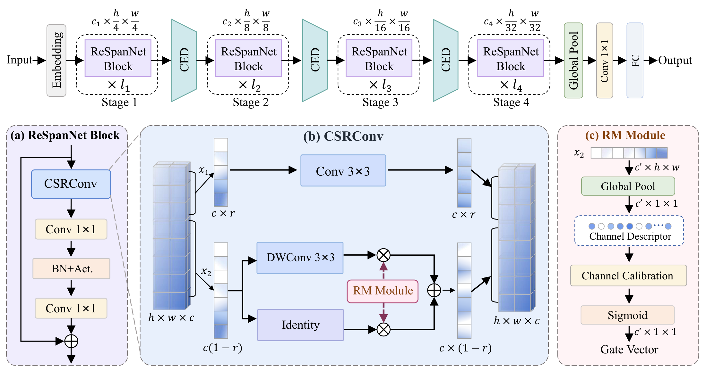
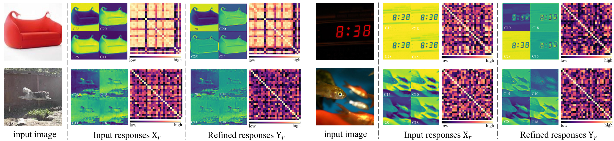
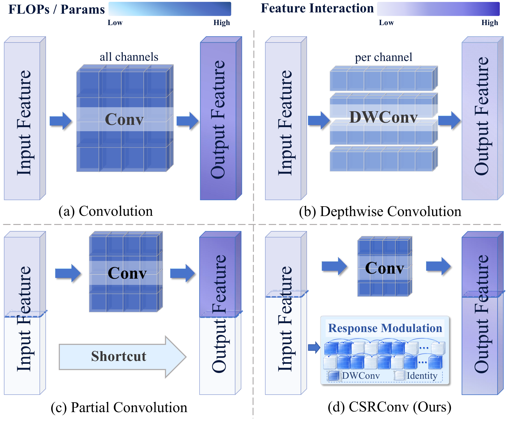
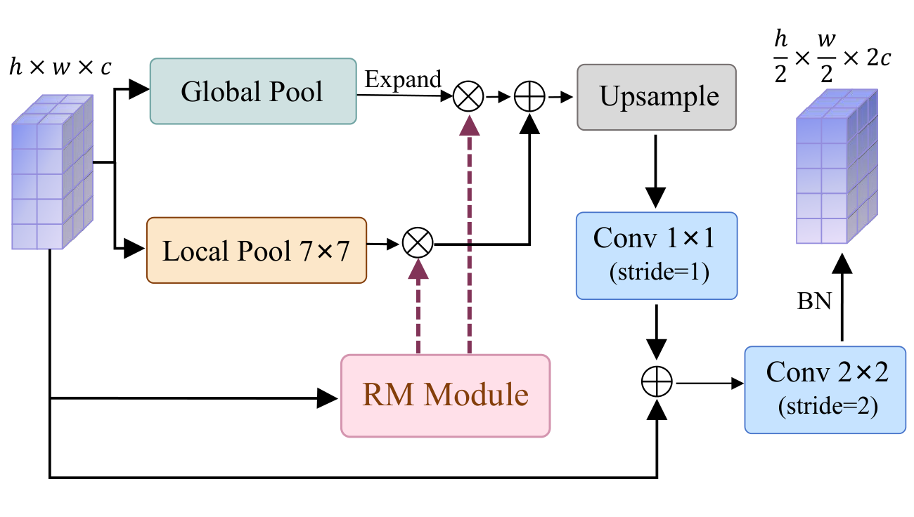

<div align="center">

# ReSpanNet

### Beyond the Dense Core: Spatial Refinement and Context Enrichment<br>for Efficient Visual Recognition

**Refine beyond the core. Enrich before downsampling.**


[](LICENSE)

[Method](#method) &nbsp;·&nbsp; [Data Preparation](#data) &nbsp;·&nbsp; [Environment Setup](#environment) &nbsp;·&nbsp; [Classification](#classification) &nbsp;·&nbsp; [Object Detection](#detection) &nbsp;·&nbsp; [Semantic Segmentation](#segmentation)

</div>

<p align="center">
  
</p>
<p align="center"><sub>The four-stage ReSpanNet architecture and its spatial refinement block.</sub></p>

PyTorch implementation of **ReSpanNet**. ReSpanNet extends spatial processing beyond a compact dense core: **Complementary Spatial Refinement Convolution (CSRConv)** refines complementary channels within a block, while **Context-Enriched Downsampling (CED)** integrates regional and global context before reducing spatial resolution.

<a id="method"></a>
## ✨ Spatial Refinement and Context Enrichment

CSRConv preserves dense spatial mixing on core channels and adds lightweight spatial refinement to the complementary channels. CED carries regional and global context into the next stage. Together, they organize spatial processing within blocks and across stage transitions.

<p align="center">
  <a href="docs/media/spatial_refinement.png"></a>
</p>
<p align="center"><sub>Input and refined responses at matching channel indices. Shared image structures remain visible as spatial emphasis and inter-channel relationships change.</sub></p>

<details>
<summary><b>Explore CSRConv and CED</b></summary>

<p align="center">
  
</p>
<p align="center"><sub>Spatial processing in dense convolution, depthwise convolution, partial convolution and CSRConv.</sub></p>

<p align="center">
  
</p>
<p align="center"><sub>CED injects regional and global context before the stage transition.</sub></p>

</details>

<a id="data"></a>
## 📦 Data Preparation

Run the commands below from the repository root. Dataset locations can be changed with `--data-root`.

### ImageNet-1K

Prepare ImageNet-1K following the [PyTorch ImageNet example](https://github.com/pytorch/examples/tree/main/imagenet). Arrange training and validation images into class subdirectories with matching class names:

```text
data/imagenet/
├── train/
│   ├── n01440764/
│   └── ...
└── val/
    ├── n01440764/
    └── ...
```

### ImageNet-100

The exact class mapping and image partitions used in our ImageNet-100 experiments are provided in [`imagenet100_split/`](imagenet100_split/): `classes.csv`, `train.txt`, `val.txt`, `test.txt`, and `split_summary.json`. The manifests contain dataset-relative paths and zero-based labels for **99,999 training**, **20,000 validation**, and **10,000 test** images. Reported ImageNet-100 experiments use the validation partition for model selection and evaluation.

Place the images under `data/imagenet100/` using the paths recorded in the manifests, then verify the files and manifest checksums:

```bash
python tools/export_imagenet100_split.py --root data/imagenet100 --output imagenet100_split --verify
```

The ImageNet-100 loader reads these manifests directly; it does not resample classes or partitions.

### COCO 2017

Download **2017 training images**, **2017 validation images**, and **2017 train/val annotations** from the [COCO download page](https://cocodataset.org/#download). Extract them into:

```text
data/coco/
├── annotations/
│   ├── instances_train2017.json
│   └── instances_val2017.json
├── train2017/
└── val2017/
```

Mask R-CNN and RetinaNet use the same images and instance annotations.

### ADE20K

Download [ADEChallengeData2016.zip](http://data.csail.mit.edu/places/ADEchallenge/ADEChallengeData2016.zip) and extract it into `data/ade/`:

```text
data/ade/ADEChallengeData2016/
├── images/
│   ├── training/
│   └── validation/
└── annotations/
    ├── training/
    └── validation/
```

Keep the original annotation labels. The configurations apply `reduce_zero_label=True` when loading ADE20K labels.

<a id="environment"></a>
## 🛠️ Environment Setup

Create separate environments for classification, detection, and semantic segmentation. The commands below use Conda and NVIDIA CUDA wheels; install PyTorch before MMCV.

### Classification

```bash
conda create -n respan-cls python=3.10 -y
conda activate respan-cls
python -m pip install torch==1.11.0+cu113 torchvision==0.12.0+cu113 --extra-index-url https://download.pytorch.org/whl/cu113
python -m pip install -r requirements/classification.txt
```

### Detection and instance segmentation

```bash
conda create -n respan-det python=3.10 -y
conda activate respan-det
python -m pip install torch==1.11.0+cu113 torchvision==0.12.0+cu113 --extra-index-url https://download.pytorch.org/whl/cu113
python -m pip install "numpy>=1.21,<1.24" "setuptools<81"
python -m pip install mmcv-full==1.6.0 -f https://download.openmmlab.com/mmcv/dist/cu113/torch1.11.0/index.html
python -m pip install -r requirements/detection.txt
```

Detection uses **MMDetection 2.25.0** and **MMCV 1.6.0**.

### Semantic segmentation

```bash
conda create -n respan-seg python=3.8 -y
conda activate respan-seg
python -m pip install torch==1.12.0+cu116 torchvision==0.13.0+cu116 --extra-index-url https://download.pytorch.org/whl/cu116
python -m pip install "numpy>=1.21,<1.24" "setuptools<81"
python -m pip install mmcv==2.0.0 -f https://download.openmmlab.com/mmcv/dist/cu116/torch1.12.0/index.html
python -m pip install -r requirements/segmentation.txt
```

Segmentation uses **MMSegmentation 1.2.2**, **MMCV 2.0.0**, and **MMEngine 0.7.1**.

<a id="classification"></a>
## 🚀 Image Classification

Activate `respan-cls`. Train ReSpanNet from random initialization on ImageNet-1K:

```bash
torchrun --standalone --nproc_per_node=8 tools/train_classification.py --variant S --data-root data/imagenet --output outputs/imagenet_S
```

Set `--variant` to **T0 / T1 / T2 / S / M / L** and choose a corresponding output directory. Scale-specific training settings are in [`configs/classification/imagenet.json`](configs/classification/imagenet.json). The trainer uses gradient accumulation to reach the configured global batch size. Adjust `--nproc_per_node` to the GPU count and `--batch-size` to the number of images per GPU and microbatch; their product must divide the global batch size. For one GPU, replace `torchrun --standalone --nproc_per_node=8` with `python`.

Train ReSpanNet-T0 on the provided ImageNet-100 partitions:

```bash
python tools/train_classification.py --dataset imagenet100 --variant T0 --data-root data/imagenet100 --split-dir imagenet100_split --output outputs/imagenet100_T0
```

Training writes `model_best.pth`, `model_last.pth`, and `training_state.pth` into the output directory. Resume with `--resume outputs/imagenet_S/training_state.pth`. Evaluate a trained classifier with:

```bash
python tools/train_classification.py --variant S --data-root data/imagenet --evaluate --checkpoint outputs/imagenet_S/model_best.pth
```

<a id="detection"></a>
## 🚀 Object Detection and Instance Segmentation

Activate `respan-det`. Use **S / M / L** with `--variant` to select the backbone scale and supply a matching checkpoint for evaluation. The configurations set the detector, normalization, and resize policy.

### Mask R-CNN

Download the pretrained weights from [Baidu Netdisk][baidu] into `weights/`, then evaluate:

```bash
python tools/evaluate.py --model maskrcnn --variant S --checkpoint weights/maskrcnn_s.pth --data-root data/coco
```

Train from random initialization:

```bash
torchrun --standalone --nproc_per_node=8 tools/train_downstream.py --model maskrcnn --variant S --data-root data/coco --output outputs/maskrcnn_S
```

Evaluation reports COCO bounding-box and instance-mask metrics.

### RetinaNet

Download the pretrained weights from [Baidu Netdisk][baidu] into `weights/`, then evaluate:

```bash
python tools/evaluate.py --model retinanet --variant S --checkpoint weights/retinanet_s.pth --data-root data/coco
```

Train from random initialization:

```bash
torchrun --standalone --nproc_per_node=8 tools/train_downstream.py --model retinanet --variant S --data-root data/coco --output outputs/retinanet_S
```

Evaluation reports COCO bounding-box metrics. Both detectors preserve aspect ratio with a maximum evaluation size of 1333 × 800.

<a id="segmentation"></a>
## 🚀 Semantic Segmentation

Activate `respan-seg`. Use **S / M / L** with `--variant` to select the backbone scale and supply a matching checkpoint for evaluation.

### DeepLabV3

Download the pretrained weights from [Baidu Netdisk][baidu] into `weights/`, then evaluate:

```bash
python tools/evaluate.py --model deeplabv3 --variant S --checkpoint weights/deeplabv3_s.pth --data-root data/ade/ADEChallengeData2016
```

Train from random initialization:

```bash
torchrun --standalone --nproc_per_node=4 tools/train_downstream.py --model deeplabv3 --variant S --data-root data/ade/ADEChallengeData2016 --output outputs/deeplabv3_S
```

### PSPNet

Download the pretrained weights from [Baidu Netdisk][baidu] into `weights/`, then evaluate:

```bash
python tools/evaluate.py --model pspnet --variant S --checkpoint weights/pspnet_s.pth --data-root data/ade/ADEChallengeData2016
```

Train from random initialization:

```bash
torchrun --standalone --nproc_per_node=4 tools/train_downstream.py --model pspnet --variant S --data-root data/ade/ADEChallengeData2016 --output outputs/pspnet_S
```

Both segmentation configurations report mIoU with whole-image inference at a single scale of 2048 × 512, preserving aspect ratio.

### Downstream training options

The commands above initialize all parameters randomly. For the ImageNet-initialized downstream setup used in the paper, append `--backbone-checkpoint outputs/imagenet_S/model_best.pth` to the training command, matching the classifier and downstream backbone scales. Task training recipes are in [`configs/training/`](configs/training/).

Change `--nproc_per_node` for the GPU count, or replace the `torchrun` prefix with `python` for one GPU. `--batch-size` sets images per GPU: the defaults are 2 for detection and 8 for segmentation. Detection learning rates scale with the total batch size relative to 16 images; segmentation uses the configured learning rate.

<details>
<summary><b>Runtime options</b></summary>

- Evaluation: `--device cuda:0` selects a GPU; `--device cpu` uses the CPU.
- Data loading: `--workers` sets worker processes; `--workers 0` loads in the main process.
- Dataset paths: `--data-root` selects the directory described in [Data Preparation](#data).
- Training outputs: `--output` sets the checkpoint directory.

Run an entry point with `--help` to view its options.

</details>

## 🤝 Acknowledgments

We thank [FasterNet](https://github.com/JierunChen/FasterNet), [PartialNet](https://github.com/haiduo/PartialNet), [MobileMamba](https://github.com/lewandofskee/MobileMamba), [MMDetection](https://github.com/open-mmlab/mmdetection), and [MMSegmentation](https://github.com/open-mmlab/mmsegmentation) for their open-source implementations. Source acknowledgments and license notices are retained in [THIRD_PARTY_NOTICES.md](THIRD_PARTY_NOTICES.md).

[baidu]: https://pan.baidu.com/s/1tnJUQMeHDfIQHCvJFC_Pog?pwd=qscd
